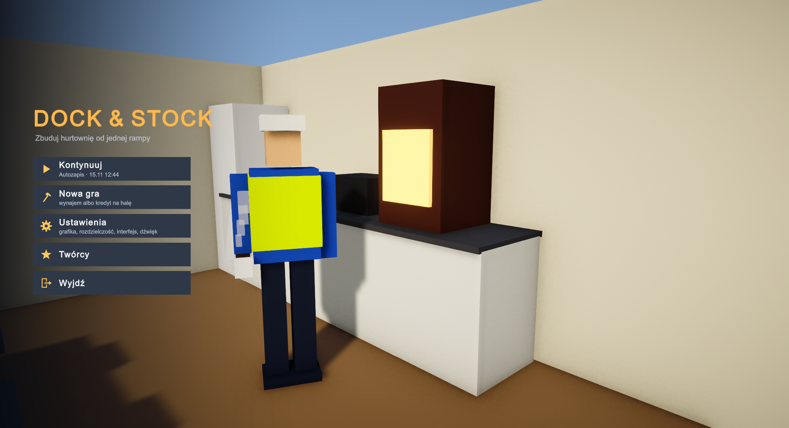

# Dock & Stock

Gra tycoon o prowadzeniu hurtowni i centrum dystrybucji. Wynajmujesz halę, stawiasz rampy i regały, zatrudniasz magazynierów, zamawiasz towar od producentów i realizujesz zlecenia klientów na czas. Z czasem rozbudowujesz halę, kupujesz własną flotę tirów i odblokowujesz kolejne poziomy. Możesz też przejść się po swojej hurtowni z kawą w ręce.

## Pobieranie

1. Wejdź w zakładkę **[Releases](../../releases/latest)**.
2. Pobierz `DockAndStock-Windows-vX.Y.Z.zip` (w nazwie jest numer wersji).
3. Rozpakuj i uruchom `DockAndStock.exe`.

Wymagania: Windows 10/11, 64-bit.

Windows może pokazać ostrzeżenie SmartScreen, bo gra nie ma jeszcze podpisu cyfrowego: kliknij **Więcej informacji → Uruchom mimo to**.

Do pobrania jest zawsze tylko najnowsza wersja. Zapisy gry z poprzednich wersji wczytują się w nowej.

## Modyfikowanie danych gry

Ceny, produkty, producenci, hale i balans są w zwykłych plikach JSON w folderze `DockAndStock_Data/StreamingAssets`. Możesz je edytować w dowolnym edytorze tekstu (zapisuj w UTF-8, przed zmianami zrób kopię). Nowe produkty dopisuj na końcu listy.

## Sterowanie (skrót)

- Kamera: WASD / strzałki – ruch, Q / E – obrót, kółko myszy – przybliżenie
- Spacer: przycisk **Spacer** albo przybliżenie do końca; G – widok z pierwszej osoby, Esc – powrót
- B – tryb budowy, X – buldożer, N – widok ścian, I – raport „Co się dzieje”
- Spacja – pauza, 1/2/3 – prędkość gry
- F5 / F9 – szybki zapis / wczytanie
- Esc → **Informator** – zasady i mechaniki gry

Gra jest we wczesnej wersji – błędy i pomysły mile widziane w zakładce **Issues**.

## Historia zmian

### 1.0.3
- Nowy wygląd interfejsu „Sterownia”: grafitowe tło, żółty akcent, czytelniejsze fonty. Górny pasek z kontem, poziomem, zakładkami zakładów, harmonogramem doków, zegarem i tempem gry; dolny pasek z grupami Operacje / Zasoby / Firma, dużym przyciskiem Budowa i licznikami (nowe zlecenia, tiry czekające na rampę).
- Tablet z nawigacją po lewej, kartami najważniejszych liczb w każdej zakładce i żółtymi przyciskami „Przyjmij”. Przy otwartym tablecie dolny pasek się chowa.
- Menu „i” jako stała szyna z lewej (Mapa / Dane) z panelem obok; działa też w fabrykach (stan linii, maszyny na mapie, magazyn, ludzie i sprzęt).
- Wykresy z ostatnich 7 dni, nowe widoki Flota oraz Zakłady i produkcja; na mapie przy każdym zakładzie palety na tydzień.
- Powiadomienia jako karty z prawej i historia pod dzwonkiem.
- Kontrakty z dostawami co 2, 3 albo 7 dni. Od reputacji 60 duże kontrakty sieci handlowych na pełne palety.
- Planer linii produkcji: ile maszyn potrzeba na zadaną liczbę palet tygodniowo.
- Fabryka: przegląd w kafelku „Fabryka”, zatrudnianie od razu widoczne, bez przenoszenia ludzi między zakładami.
- Poprawki: tiry pod dokami chłodni nie zawracają kilka razy, liczniki hurtowni nie liczą ludzi i tirów fabryk, przeprowadzka hali nie wyrzuca ludzi z fabryk, rzetelniejszy bilans towaru.

### 1.0.2
- Ziemia w Centrum zarządzania od nowa: mapka działek obok szczegółów wybranej działki, wszystkie towary widoczne naraz i przycisk „Kup działkę” zawsze w zasięgu. Bez wybranej działki – lista wszystkich działek z wymiarami i ceną.

### 1.0.1
- Regały: wózek widłowy obsługuje regały z alejki 2 kratek (poziomy 0–2). Wózek wysokiego składowania jest potrzebny tylko na poziomy 3–4. Okno regału, zakładka Sprzęt i komunikat pokazują, które miejsca są poza zasięgiem sprzętu i co zrobić.
- Bilans towaru (Kontrakty → Bilans towaru): tygodniowy popyt z kontraktów odbiorców i zleceń kontra dostawy z kontraktów, zapas w dniach i ocena OK / RYZYKO / BRAKNIE.
- Automat dostaw: sam podpisuje albo powiększa kontrakty dostaw, gdy popyt nie jest pokryty. Automat kontraktów odbiorców nie przyjmuje kontraktu, którego producenci nie zaopatrzą.
- Interfejs: mniejszy i bez nakładania się paneli, bez poziomych pasków przewijania, przycięte zbędne podpowiedzi. Zakupy mieszczą się w oknie.
- Fabryki: F1 pokazuje i ukrywa linie połączeń maszyn; rura biegnąca obok maszyny ma widoczne zejście do niej.

### 1.0.0
- Fabryki: kupujesz działkę i stawiasz fabrykę jednego z 11 towarów (woda, napój, proszek, mydło w płynie i w kostce, chipsy, czekolada, jogurt, ser, lody, mrożone warzywa). Każda linia ma własne maszyny, które łączysz taśmami i rurami jak w Factorio (prowadzenie myszką, łuki 90°, dołączanie taśmy z boku). Woda płynie rurą z ujęcia (pompa 1,5 m³/h).
- Fabryki w praktyce: okno maszyny (co wchodzi, co wychodzi, z czym połączyć i czy jest połączone, przestawianie za darmo), linie połączeń nad halą (zielone = są, czerwone = brak), wloty i wyloty widoczne na modelach, komory chłodnicze, własni pracownicy, sprzęt i rekrutacja, sprzedaż hurtowa i przywożenie towaru do hurtowni (Zakupy albo Flota).
- Statystyki fabryk w jednostkach SI: wydajność maszyn (kg/h, L/h), obciążenie z ostatniej godziny, moc w kW, bilans wody, zużycie surowców i zapas w godzinach.
- Mapa: oddal kamerę, żeby zobaczyć działki przy trzech ulicach; kółkiem przybliżasz się prosto do zakładu pod kursorem. Sieć dróg, drzewa, światła nocą we wszystkich zakładach.
- Baza floty na osobnej działce: parking na 150 zestawów, hotel kierowców (kierowcy chodzą pieszo do swoich ciężarówek), panel floty w stylu ETS2 (kolor każdego zestawu, stały kierowca), odbiory czekające na wolny zestaw z realnym czasem przyjazdu.
- Kontrakty dostaw w osobnej zakładce: próg albo stała dostawa w wybrane dni i godziny, okres albo bezterminowo, stała cena, kara za zerwanie.
- Sprzęt z grafikami i leasingiem na raty (do 10 albo 20 rat).
- Doki: karta każdego doku z opisem rodzaju (rozładunek / załadunek / oba) i pierwszeństwa, edycja numeru, podgląd.
- Wszystkie budynki (hala, chłodnia, socjalne, hotel, warsztat) mają tryby ścian: przekrój, ściany niskie, z dachem.
- Informator: jak łączyć maszyny i przykłady wszystkich linii produkcji.
- Mniejsze: najwyżej 3 pracowników przy jednym tirze, bezczynni odkładają przyjęte palety na regały, szybkie wysyłanie na szkolenie, kamera wraca po spacerze, automat w Centrum zarządzania nie pokazuje okienek, przycisk Zgłoś błąd.

Zapisy z poprzednich wersji wczytują się; fabryki z dawnych zapisów przenoszą się na nowe miejsca działek.

### 0.5.0
- Chłodnia: osobny budynek na placu obok hali (zakładka Hala). Budowa trwa dobę, potem włączasz generator chłodu: +8 °C po ok. pół godzinie, -18 °C po 4-5 h. Cały towar chłodzony i mrożony trafia do chłodni (własne doki od południa), pracownicy i sprzęt są wspólni. Chłodnię można rozbudować na wschód i północ. Lodówki przy regałach zniknęły: w starych zapisach regały chłodnicze stają się zwykłe, ze zwrotem części kosztu.
- Regały: przypisanie do kategorii albo konkretnego produktu (Organizacja albo klik w regał). Towar, który nie pasuje, pracownicy przekładają, a w wolnym czasie przewożą towar z regałów ogólnych na przypisane.
- Kontrakty: nowe na górze listy zleceń i własne fioletowe okienko „Nowy kontrakt”. Przy reputacji 90+ duże zamówienia sieci handlowych.
- Finanse: na co idą pieniądze (kategorie, dziś / wczoraj / 7 dni) i obrót towaru.
- Stałe dostawy: dni tygodnia, godzina, okres i producent; gra zamawia najtańszym trybem, który zdąży.
- Dok: roleta bramy zwija się do góry, tir otwiera drzwi, a w środku widać palety. Małe zlecenia odbiera biały bus.
- Rampa: najpierw wjeżdża tir, dla którego są gotowe palety; tir bez gotowego towaru zjeżdża na parking.
- Bankructwo: najpierw dotacja rządowa, potem komornik (wybierasz, co oddajesz), dopiero za trzecim razem koniec gry.
- Klikanie palet na wysokich poziomach regałów działa poprawnie; ręczne przenoszenie na wskazany poziom regału.
- Płynne przewijanie list i zoomu, ściany rosną z najwyższym regałem, pracownicy z uprawnieniami biorą najpierw wózek widłowy, przestój tira dostawcy liczony dopiero po 3 h.

### 0.4.1
- Kółko myszy przybliża dużo mocniej (ok. 28% na ząbek przy czułości 100%, suwak do 400%); listy i panele przewijają się 3x szybciej.
- Ustawienia: zmiany zapisują się dopiero po „Zastosuj zmiany”; nowy przycisk „Przywróć domyślne”; „Wróć bez zmian” cofa niezastosowane zmiany.

### 0.4.0
- Zakupy: kafelki produktów ze zdjęciami; każdy produkt u kilku producentów, którzy różnią się ceną i czasem dostawy; cenniki zmieniają się co 3 dni; wybór czasu dostawy (48 h taniej, 24 h, 8 h drożej albo własny tir).
- Zlecenia: lista w sekcjach (nowe, w realizacji, kontrakty, zakończone) i szczegóły z rozliczeniem po prawej.
- Oś czasu na górnym pasku: przyjazdy dostaw oraz odbiory i dostawy do klientów w najbliższych 24 h.
- Tryb spaceru: chodzisz postacią po hali i placu, widok z pierwszej osoby (G) z kawą w ręce.
- Informator w menu Esc: zasady i mechaniki gry.
- Regał przepływowy na 3 palety: pełna paleta sama zjeżdża w dół.
- Oświetlenie nocą w hali i na placu.
- Ludzie i wózki poruszają się 2,5 raza szybciej.
- Strefy obklejone taśmą w ukośne pasy, czerwone krzyżyki na kafelkach bez dojazdu.
- Większe okno nowego zlecenia, Postęp nie nakłada się na inne panele, matowe plandeki tirów.

### 0.3.0
- Nowe zlecenie wyskakuje w oknie (Przyjmij / Odrzuć / Później); nieprzyjęte oferty znikają przed terminem odbioru.
- Klik na pracownika, paletę albo tira pokazuje, co robi, do jakiego zlecenia jest paleta i dokąd jedzie tir.
- Ręczne przenoszenie palet myszką.
- Wybór produktów, które oferujesz klientom.
- Wykup wynajmowanej hali za gotówkę albo na kredyt.
- Poziom firmy nie spada, gdy reputacja chwilowo spadnie.
- Ludzie: lista według zmian, czytelne okno szczegółów.
- Kolizje tylko między wózkami widłowymi.
- Kamera przybliża bliżej, suwaki czułości.
- Podgląd doku przy budowie, darmowe stałe punkty kompletacji, osobne kategorie regałów, czytelne statusy zleceń.

### 0.2.0
- Rozładunek: palety trafiają tylko tam, gdzie da się dojechać; strefa przyjęć zapełnia się od najdalszych miejsc.
- Wybór monitora w ustawieniach.
- Numery ramp na placu i na tablicy nad bramą.

### 0.1.0
- Pierwsze wydanie na Windows.
- Flota: zestawy w trasie zostają w trasie po wczytaniu zapisu.
- Tryby widoku ścian (przekrój / niskie / z dachem) dla wszystkich budynków.
- Pierwszeństwo na rampie przy kolejce tirów.
